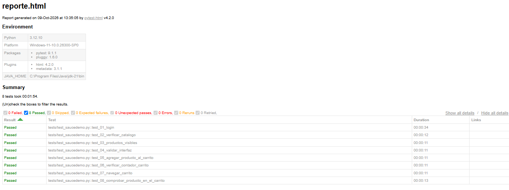

# Pre-entrega Automation Testing: SauceDemo

## Propósito del proyecto

Proyecto de la pre-entrega del curso de QA Automation (Talento Tech). Automatiza con Selenium WebDriver y Python tres flujos básicos del sitio de práctica [saucedemo.com](https://www.saucedemo.com):

1. **Login** con credenciales válidas y validación de la redirección a `/inventory.html`.
2. **Navegación y verificación del catálogo**: título, productos visibles, elementos de la interfaz (menú y filtro) y nombre/precio del primer producto.
3. **Interacción con el carrito**: agregar el primer producto, verificar el contador, navegar al carrito y comprobar que el producto aparece.

## Tecnologías utilizadas

- Python 3.12
- Selenium WebDriver
- Pytest
- pytest-html (reporte HTML)
- Git y GitHub

## Estructura del proyecto

```
pre-entrega-automation-testing-carla-jimenez/
├── tests/
│   └── test_saucedemo.py   # Casos de prueba
├── utils/
│   └── helpers.py          # Funciones auxiliares (login)
├── reports/
│   └── reporte.html        # Reporte de la última ejecución
├── conftest.py
├── pytest.ini              # Configuración de pytest (genera el reporte)
└── README.md
```

## Instalación de dependencias

1. Tener instalado Python y Google Chrome.
2. Clonar el repositorio:
```
   git clone https://github.com/Carliabi/pre-entrega-automation-testing-carla-jimenez.git
   cd pre-entrega-automation-testing-carla-jimenez
```
3. Instalar las librerías:
```
   pip install selenium pytest pytest-html
```

## Cómo ejecutar las pruebas

Desde la carpeta principal del proyecto:

```
pytest -v
```

Si el comando `pytest` no es reconocido en Windows, usar:

```
python -m pytest -v
```

El reporte HTML se genera automáticamente en `reports/reporte.html` gracias a la configuración de `pytest.ini`. Es equivalente a ejecutar:

```
pytest -v --html=reports/reporte.html --self-contained-html
```

## Casos de prueba

| Test | Qué verifica |
|---|---|
| `test_01_login` | Login exitoso: URL con `/inventory.html`, título "Swag Labs" y sección "Products" |
| `test_02_verificar_catalogo` | Título de la página y de la sección |
| `test_03_productos_visibles` | Hay productos visibles; muestra nombre y precio del primero |
| `test_04_validar_interfaz` | El menú y el filtro están visibles |
| `test_05_agregar_producto_al_carrito` | El botón del primer producto cambia a "Remove" |
| `test_06_verificar_contador_carrito` | El contador del carrito muestra "1" |
| `test_07_navegar_carrito` | Se navega a `/cart.html` |
| `test_08_comprobar_producto_en_el_carrito` | El producto agregado aparece en el carrito |

Los tests son independientes entre sí: cada uno abre su propio navegador y hace su propio login.

## Reporte

El reporte de la última ejecución está en `reports/reporte.html` (descargar y abrir en el navegador).



## Autora

Carla Jimenez
